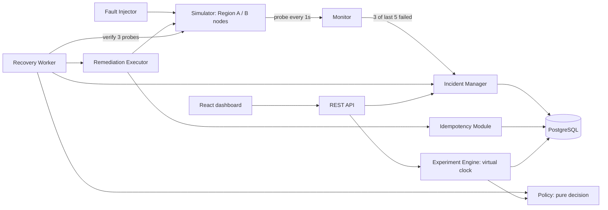

# Architecture

## Component flow

## Why decision and execution are separate

`RecoveryPolicy.decide(PolicyContext)` is a pure function of counters, failure type, elapsed time and backup health.
It has no I/O, so it is unit-testable and the experiment engine can run the very same classes on a virtual clock.
`RemediationService` only executes; `RecoveryWorker` only orchestrates.

## Live recovery loop (one tick per second)

1. `DETECTED` -> `ANALYZING`.
2. `ANALYZING`: build `PolicyContext` (counts for the current epoch), ask the incident's policy, persist a `policy_runs`
   row (decision, reason, rejected alternatives). `ESCALATE` -> `ESCALATED`, `GIVE_UP` -> `FAILED`, otherwise create a
   `PENDING` action scheduled `delay` ms ahead and move to `REMEDIATING`.
3. `REMEDIATING`: when the action is due, mark `RUNNING`, execute through the idempotency module, then verify with
   3 consecutive healthy probes. Healthy -> `RECOVERED`; otherwise back to `ANALYZING` for another decision.

State lives in PostgreSQL, so after an application restart the next tick resumes. A `RUNNING` action is simply re-executed
under the same idempotency key, which reconciles instead of repeating the effect.

## Recovery safeguards

* Global cap of 8 actions per incident and a 240 s time budget (then `ESCALATE`).
* Failover is rejected when no healthy backup exists.
* Policies never loop: each has bounded retries and restarts.
* Operator re-open starts a new epoch, so counters reset deliberately and visibly.

## Data model

`service_nodes`, `fault_injections`, `incidents`, `incident_state_transitions`, `remediation_actions`,
`idempotency_records`, `policy_runs`, `experiment_runs`. Schema in `backend/src/main/resources/db/migration/V1__schema.sql`.
Timestamps are UTC (`TIMESTAMPTZ`); the dashboard shows UTC.

## Policies

| Policy | Behaviour |
|---|---|
| `FIXED_RETRY` | Retry every 3 s, up to 5 times, then give up. Baseline. |
| `EXPONENTIAL_BACKOFF` | Retry after 2/4/8/16 s, then restart up to twice, then give up. Never fails over. |
| `COST_AWARE` | Cheapest action likely to work for the observed failure type; immediate failover on suspected region outage. |
